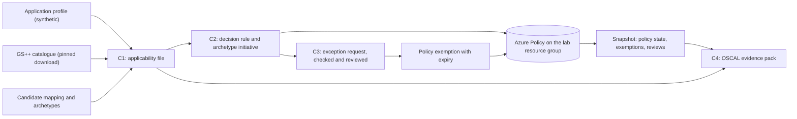

# **From Requirement to Evidence: governing sovereign requirements on Azure**

> **Status (23 Nov 2026): offline rehearsal complete; first live Azure run in progress.** The [validation record](walkthrough/validation-run.md) distinguishes observed policy results from pending checks. Exception approval and expiry, complete evidence collection, billed cost and teardown are not yet validated.

An architect can take a sovereign requirement set (BSI Grundschutz++ and C5), decide which requirements apply to an application, enforce them with native Azure Policy by a stated decision rule, handle a justified exception as a reviewed pull request, and generate machine-readable audit evidence as a by-product.

Four challenges, run on their own or after the Sovereign Cloud MicroHack.

- [**Introduction**](#introduction)
- [**Objectives**](#objectives)
- [**Prerequisites**](#prerequisites)
- [**Architecture**](#architecture)
- [**Setup**](#setup)
- [**Challenges**](#challenges)
- [**Value readout**](#value-readout)
- [**Known limitations**](#known-limitations)
- [**When not to use it**](#when-not-to-use-it)
- [**Sovereignty notes**](#sovereignty-notes)
- [**Data sources and attribution**](#data-sources-and-attribution)
- [**Contributors**](#contributors)

## Introduction

This MicroHack builds on the [Microsoft Sovereign Cloud MicroHack](https://github.com/microsoft/MicroHack/tree/main/03-Azure/01-03-Infrastructure/01_Sovereign_Cloud), whose seven challenges enforce sovereign controls with Azure Policy, RBAC, encryption, confidential computing, Azure Arc, Azure Local and adaptive apps (microsoft/MicroHack, checked 20 Nov 2026). It complements them with the governance around those controls, taking an architect from requirements to evidence through three questions:

1. **Which sovereign requirements apply to this application?**
2. **What happens with a justified exception?**
3. **How do I prove compliance to an auditor?**

| Term | Meaning |
|---|---|
| BSI | *Bundesamt für Sicherheit in der Informationstechnik*, the German Federal Office for Information Security |
| Grundschutz++ (GS++) | BSI's machine-readable baseline security catalogue, published in OSCAL |
| C5 | *Cloud Computing Compliance Criteria Catalogue*, BSI's criteria for cloud service providers |
| MUSS / SOLLTE / KANN | must / should / may: the requirement level (modal verb) of each GS++ requirement |
| OSCAL | Open Security Controls Assessment Language, NIST's machine-readable format for catalogues, components and assessment results |
| Archetype | A landing-zone type (Corp, Online, Confidential Corp) that decides which requirements bind an application |

> **The catalogue behind the challenges.** The requirements come from BSI's Grundschutz++ catalogue, published in the [BSI-Bund/Stand-der-Technik-Bibliothek](https://github.com/BSI-Bund/Stand-der-Technik-Bibliothek) repository ([BSI's Grundschutz++ page](https://www.bsi.bund.de/DE/Themen/Unternehmen-und-Organisationen/Standards-und-Zertifizierung/Grundschutz-in-der-Informationssicherheit/Grundschutz-Plus-Plus/grundschutz-plus-plus_node.html)). The kit pins one commit and its SHA-256 digest and never follows "latest". **Configure the pin** in the `catalogue` block of [`resources/catalogue-mapping.json`](resources/catalogue-mapping.json), the only place it is set. To use a newer BSI release, follow [Upgrade the catalogue](resources/README.md#upgrade-the-catalogue).

## Objectives

After the four challenges you can:

- derive the requirements that apply to one application from a pinned, digest-verified catalogue (challenge 1);
- choose an Azure Policy effect for each requirement by a stated decision rule and deploy it as an archetype initiative (challenge 2);
- raise a time-boxed exception as a reviewed pull request, and show that a must-level (MUSS) requirement cannot be excepted (challenge 3);
- generate a reproducible evidence pack from policy state and pull-request history (challenge 4).

## Prerequisites

| Need | Offline route | Azure route | Notes |
|---|:---:|:---:|---|
| Python 3.10 or later (validated with 3.13) and Git | ✔ | ✔ | Standard library, except OSCAL schema validation: `tools/oscal/requirements.txt` |
| PowerShell 7 and Azure CLI with Bicep | ✔ | ✔ | Offline, the CLI only compiles Bicep; no sign-in |
| HTTPS access to github.com and the NIST OSCAL schemas | ✔ | ✔ | Downloads the pinned catalogue and the schemas: offline means no Azure, not air-gapped |
| A disposable Azure sandbox subscription, with written approval of a dated budget and a named owner for cleanup | | ✔ | Owner of the subscription, or the narrower [rights in walkthrough 2](walkthrough/challenge-02/solution-02.md#rights); never a production subscription |
| GitHub CLI, a GitHub repository you administer whose `main` branch can be protected, and a second account as risk owner | | ✔ (challenges 3 and 4) | Public on GitHub Free, or private on GitHub Pro, Team or Enterprise |
| [Sovereign Cloud MicroHack challenge 1](https://github.com/microsoft/MicroHack/blob/main/03-Azure/01-03-Infrastructure/01_Sovereign_Cloud/challenges/challenge-01.md) | recommended | recommended | Azure Policy and RBAC basics, not repeated here |

Each challenge lists its own prerequisites in full.

## Architecture

The applicability file and generated policy set connect the four challenges. Scripts derive the files; people review the mapping, decide whether to accept a risk and assess the evidence.

| Challenge | Takes | Produces | Offline route | Azure route adds |
|:---------:|-------|----------|---------------|------------------|
| 1 | Application profile, pinned GS++ catalogue, candidate mapping, archetypes | Applicability file: each mapped requirement in or out of scope, with its reason, candidate controls and gaps | All of it | Nothing: challenge 1 needs no Azure |
| 2 | Applicability file, decision rule (modal verb, checkable by Azure Policy, binding for the archetype) | Effect and deviation path per requirement; policy set and assignment as Bicep | Classify, generate and compile | Assign to the lab group and check the expected deny, audit, modify and deployIfNotExists effects |
| 3 | Initiative, exception request as a JSON file | A permitted or refused request; risk-owner approval; Policy exemption with expiry | Request checks against a fixed clock | Pull-request review under branch protection; the exemption in Azure; its expiry |
| 4 | Snapshot of policy state, exemptions and pull requests; applicability file; initiative; catalogue | OSCAL assessment results and a readable summary, reproducible from the same inputs | Two packs from a frozen synthetic snapshot, compared | A snapshot of the live lab |

| Folder | Holds |
|---|---|
| `challenges/` | What to achieve, with success criteria |
| `walkthrough/` | Step-by-step solutions and the [validation run](walkthrough/validation-run.md) record |
| `resources/` | The shared data contract: mapping, decision rule, archetypes, schemas, synthetic profiles ([index](resources/README.md)) |
| `tools/` | The scripts each challenge runs |
| `labautomation/` | Sandbox setup and teardown, and the offline rehearsal |

## Setup

Use a checkout that includes the completed files for all four challenges and the lab runbook. If the runbook or [validation record](walkthrough/validation-run.md) is missing, you have a partial kit, not the checkout used for the rehearsal. From the folder containing this Readme, choose a route:

| Route | Runs | Needs | Start |
|---|---|---|---|
| **Offline rehearsal** | All four handoffs on synthetic inputs: catalogue and applicability, decision rule and Bicep compilation, exception-request checks, an evidence pack generated twice and compared | The offline prerequisites; no Azure sign-in, GitHub repository or model calls | [Rehearse all four handoffs without a sandbox](labautomation/README.md#rehearse-all-four-handoffs-without-a-sandbox) |
| **Azure sandbox** | The challenges as written, with live policy effects, a reviewed exemption, evidence from live state, and teardown | An approved, dated budget for this lab and all prerequisites above | [Start a live run only after approval](labautomation/README.md#start-a-live-run-only-after-approval), then [challenge 1](challenges/challenge-01.md) |

The offline rehearsal shows that the handoffs fit together; it does not show that Azure enforces them. The Azure route is in partial live validation: see the [validation record](walkthrough/validation-run.md) for observed results and open checks. Follow [teardown](labautomation/README.md#finish-including-after-a-failure) at the end of the run, including after a failure.

## Challenges

| Challenge | Topic | Challenge | Solution | Duration |
|:---------:|-------|-----------|----------|----------|
| 1 | Decide which sovereign requirements apply to an application | [Challenge](challenges/challenge-01.md) | [Solution](walkthrough/challenge-01/solution-01.md) | to be measured |
| 2 | Enforce applicable requirements with Azure Policy by a decision rule | [Challenge](challenges/challenge-02.md) | [Solution](walkthrough/challenge-02/solution-02.md) | to be measured |
| 3 | Handle a justified exception as a reviewed pull request | [Challenge](challenges/challenge-03.md) | [Solution](walkthrough/challenge-03/solution-03.md) | to be measured |
| 4 | Generate audit evidence as a by-product of change | [Challenge](challenges/challenge-04.md) | [Solution](walkthrough/challenge-04/solution-04.md) | to be measured |

Then [finish](challenges/finish.md): clean up and check your answers to the three questions.

## Value readout

**Offline maintainer rehearsal (20 Nov 2026), followed by partial live validation (23 Nov 2026).** The [validation record](walkthrough/validation-run.md) gives the current observed results, pending checks and limitations. The offline exercise covered synthetic fixtures and 10 profiles, not an independent novice. Its Azure cost was not applicable; the separate live run's cost is still pending and must not be inferred from subscription totals.

For each synthetic run, report the date, sample size, elapsed minutes per step, failures (including retries) and attributable Azure cost. Report minutes *saved* only against a timed manual comparison. These are sandbox observations, not production lead times.

| Challenge | Saves | Measured as | Result |
|:---------:|-------|-------------|--------|
| 1 | Reading the whole catalogue for each application | Minutes from application profile to applicable-requirement list; agreement with expert-labelled applicability | Offline: 10 synthetic profiles passed; leave planner 17/23 applicable. Reader duration and expert agreement not measured. |
| 2 | Choosing and defending a policy effect per requirement by hand | Minutes from requirement list to deployed initiative; deployed effects that differ from the decision rule | Live: TLS, residency and public-network Deny, anonymous-access Modify, Key Vault diagnostics and the full compliance scan behaved as expected. Hosting-tenant Modify policies can pre-empt Deny; see the challenge 2 walkthrough. |
| 3 | Chasing exception decisions through mail and tickets | Minutes from request to approved exemption; exemptions without approver or expiry | Offline: permitted request and four expected refusals matched. Live approval and Azure expiry UNVALIDATED. |
| 4 | Assembling audit evidence by hand before each review | Minutes to regenerate the evidence pack; differences between two runs on the same state | Offline: two synthetic leave-planner packs, 23 findings each, byte-identical; 0.586/0.556 seconds per generation command. No live telemetry or savings measured. |

## Known limitations

- The requirement mapping is a **candidate**: no information-security expert has reviewed it. It is not a compliance statement.
- The mapping covers a selected slice of GS++ requirements and a few Azure resource types, not the whole catalogue.
- Azure Policy checks resource configuration only. Identity, data and process requirements route to Microsoft Entra, Microsoft Purview or a named human decision, and show as coverage gaps.
- Azure Policy exemptions make expiry optional; this lab makes it mandatory with a pull-request check, which protects only exemptions raised through that check.
- The evidence collector reads policy state, exemptions and pull requests only. Requirements that need Entra logs, Purview records or manual attestations stay unresolved.
- The offline rehearsal uses a frozen synthetic snapshot: its approvals and observations are fixtures, not actions it performed.
- One lab run per subscription at a time: the policy set name is subscription-wide. Policy evaluation is asynchronous, so live steps include waits.

## When not to use it

- You need a certification or an auditor's opinion: the lab produces evidence for an assessor, not a verdict.
- Your requirement set has no modal verbs comparable to GS++: the decision rule depends on them.
- You want to enforce policy in production: the lab assigns to one sandbox resource group. Production assignments belong in your landing-zone policy-as-code pipeline, for example [Enterprise Policy as Code](https://azure.github.io/enterprise-azure-policy-as-code/).
- Nobody can act as a separate risk owner: the exception check depends on the approver not being the requester.

## Sovereignty notes

Availability differs per cloud; check each service before a run. Never assume parity.

| Cloud | Note for this lab | Source, date checked |
|---|---|---|
| EU Data Boundary | Azure Policy is temporarily excluded: policy entities and compliance information may be processed outside the EU. Treat policy state, and evidence derived from it, accordingly | [Microsoft Learn, EU Data Boundary temporary transfers](https://learn.microsoft.com/en-us/privacy/eudb/eu-data-boundary-temporary-transfers-from-services), updated 27 Mar 2026 |
| Any | No C5 or IT-Grundschutz initiative found among the Azure Policy built-in initiatives (bounded check), so the lab builds its own from the mapping | [Microsoft Learn, built-in initiatives](https://learn.microsoft.com/en-us/azure/governance/policy/samples/built-in-initiatives), checked 18 Nov 2026 |
| Sovereign Public Cloud | Not checked for this lab | none |
| Sovereign Private Cloud | Azure Policy and Azure Resource Manager are documented for disconnected operations on Azure Local; whether each effect used here behaves the same is unverified | [Microsoft Learn, disconnected operations overview](https://learn.microsoft.com/en-us/azure/azure-sovereign-clouds/private/azure-local/disconnected-operations-overview), checked 18 Nov 2026 |
| Delos Cloud | Azure Policy is listed as planned on a portfolio that Delos states is non-binding | [Delos Cloud portfolio](https://www.deloscloud.de/products/portfolio.html), accessed 2 Nov 2026 |

## Data sources and attribution

| Source | Licence | How this lab uses it |
|---|---|---|
| [BSI Stand-der-Technik-Bibliothek](https://github.com/BSI-Bund/Stand-der-Technik-Bibliothek), Grundschutz++ catalogue, at the commit pinned in the `catalogue` block of [`resources/catalogue-mapping.json`](resources/catalogue-mapping.json) | CC BY-SA 4.0 | Downloaded and digest-checked at run time by `tools/gspp/extract.py`; this folder holds requirement IDs and its own mapping only, never catalogue text. [Upgrade procedure](resources/README.md#upgrade-the-catalogue) |
| [BSI C5:2026, machine-readable](https://www.bsi.bund.de/SharedDocs/Downloads/EN/BSI/CloudComputing/ComplianceControlsCatalogue/2026/C5_machine_readable.html) (checked 17 Nov 2026) | CC BY-ND 4.0 | Referenced, not redistributed |
| [Microsoft Sovereign Cloud MicroHack](https://github.com/microsoft/MicroHack/tree/main/03-Azure/01-03-Infrastructure/01_Sovereign_Cloud) | MIT | Layout and challenge conventions |

## Contributors

Listed at submission.
